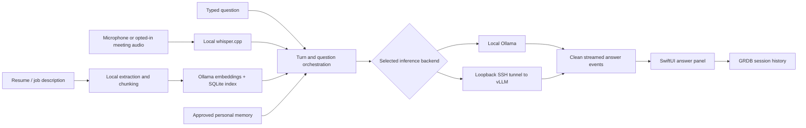

# Veya

[](https://github.com/Yaswanth2120/Veya/actions/workflows/ci.yml)

A native macOS interview-practice assistant that turns spoken or typed questions into streamed, document-informed answers. Built with **SwiftUI/AppKit, Python, whisper.cpp, Ollama embeddings, SQLite/GRDB, and vLLM-compatible Responses inference**.

Veya supports local Ollama generation or an explicitly selected rented GPU through an SSH tunnel. Raw audio, document embeddings, and session storage remain on the Mac. GPU mode sends questions and selected document, memory, and conversation text to the remote server.

**Status:** working local development prototype. Core pipelines, native form editing, and GPU-backed answer display have been exercised. Live Zoom/Google Meet capture, broad answer-quality evaluation, and a portable notarized release remain future validation work. See [validation evidence](docs/VALIDATION.md).

## What it does

- Captures microphone audio locally; supports opted-in meeting/system audio through ScreenCaptureKit. Meeting audio can run without a microphone track.
- Transcribes incrementally with whisper.cpp; Apple Silicon defaults to **Whisper base.en**, an English-only model.
- Assembles spoken turns, filters non-speech artifacts, detects question candidates, and queues up to three later questions while preserving the current answer.
- Indexes resume, job-description, and supporting `.txt`, `.md`, `.pdf`, and `.docx` documents with local `nomic-embed-text` embeddings and session-scoped SQLite vector retrieval.
- Streams clean answer text without reasoning blocks; attaches references to the actual retrieved chunks. A narrow percentage guard catches some unsupported numeric claims, but is not a general fact-checker.
- Accepts typed questions through the same retrieval and answer pipeline, retaining bounded preceding question context.
- Saves session history and reports; durable personal memory requires explicit user approval.
- Provides backend health/model discovery, explicit tunnel/context errors, and a selectable served GPU model. It does not silently switch inference hosts.

Coding and system-design workspaces remain in the codebase, with versioned edits and exports. The active **Create Session flow is interview practice**; those workspaces are not additional validated product modes.

## Architecture



Swift owns the source-of-truth session, transcript, question, answer, and profile records. A managed Python subprocess owns inference, transcription, retrieval indexes, and derived caches. Communication uses versioned JSON Lines over private stdin/stdout. Worker health checks, bounded restarts, ordered answer scheduling, and session teardown keep failures explicit.

## Verified results — November 20, 2026

| Check | Result |
|---|---|
| Python regression suite | **484 tests discovered: 480 passed, 4 opt-in tests skipped** |
| Swift regression suite | **228 passed** across 30 suites |
| Combined executed tests | **708 passed** |
| Native application UI | All four New Session fields accepted keyboard input; valid input enabled creation; a diagnostic session displayed a GPU answer and ended successfully |
| Signed development bundle | Release build and deep/strict signature verification passed, including verification after real worker execution |
| Packaged typed question + long synthetic context | GPT-OSS 120B: **2.048 s** to first usable text; **2.912 s** to answer completion |
| Packaged meeting-track audio replay, no microphone track | GPT-OSS 120B + streaming ASR: **10.544 s** to first usable text; **11.359 s** to answer completion |

Timing rows are **single synthetic acceptance samples**, not medians, p95s, or guarantees. Typed timing starts at submission; replay timing includes session/ASR startup and paced input, so these rows are not directly comparable. The replay check does not exercise ScreenCaptureKit or a real meeting platform. Machine-readable reports: [typed](docs/results/typed-acceptance.json), [meeting-track replay](docs/results/meeting-track-acceptance.json).

These checks establish functioning integrations and specific fixture assertions. They do **not** establish an answer-accuracy percentage or a measured improvement over the earlier local model.

## What improved in this iteration

| Earlier behavior | Current behavior |
|---|---|
| Answer generation assumed local Ollama | Selectable Ollama or tunneled Responses backend, tested with GPT-OSS 120B and a separately served Qwen model |
| A changed served model could cause stale model requests | Single-model discovery when no explicit override is set; explicit overrides remain strict and configurable |
| Only the first 240 characters of a retrieved passage reached generation | Bounded full passages, up to 800 characters each, reach the prompt; short excerpts remain display metadata |
| Larger prompts could be rejected by a byte approximation | Larger prompts use vLLM's tokenizer within the configured budget, with room reserved for output and template overhead |
| New Session editing and disabled creation were confusing | Native editable fields, visible validation, duplicate-submit protection, first-document resume labeling, and attachment removal |
| A stale overlay frame could cover the main window | Restored frames are bounded; the overlay hides while Veya is active and has a hide control |
| Meeting capture depended on an active microphone track | Meeting-only transcription can share a typed-session orchestrator |
| Permission checks relied solely on a legacy preflight | Explicit permission request/re-check and authorization through ScreenCaptureKit |
| Failures could appear as a generic local-model error | Safe backend-specific errors preserve the failed question for retry |
| Development app identity was only linker-signed | Full ad-hoc bundle/helper signing, sealed resources, and no worker bytecode writes inside the signed bundle |

## Development setup

Requirements: macOS 14+, Swift 6 toolchain, Python 3.10+, Git, CMake for Whisper, and Ollama for local document embeddings. The verified workstation used Apple Silicon and Python 3.14.6. Automated Python CI targets 3.12 and 3.14; macOS CI builds and tests Swift.

```sh
python3 -m venv .venv
source .venv/bin/activate
python -m pip install -e core
ollama pull nomic-embed-text
# For local answer generation, also install the worker's default model:
ollama pull llama3.2
swift build
sh run-tests.sh
```

Keep Ollama running. `swift run Veya` is useful for UI development; use a packaged app for microphone/ScreenCaptureKit permission testing.

### Build local speech recognition

The external whisper.cpp checkout is intentionally ignored by Git. This revision was used for the recorded checks:

```sh
git clone https://github.com/ggml-org/whisper.cpp.git whisper.cpp
git -C whisper.cpp checkout 5eaee0cc9024eb9e9a99469199920c8b7f5cb9ec
sh packaging/install_streaming_asr_source.sh
cmake -S whisper.cpp -B whisper.cpp/build -DCMAKE_BUILD_TYPE=Release -DBUILD_SHARED_LIBS=OFF -DGGML_METAL=ON -DWHISPER_BUILD_TESTS=OFF
cmake --build whisper.cpp/build --target whisper-cli whisper-stream-stdin -j 4
```

The packaged app downloads the architecture-specific model in `packaging/whisper_model_manifest.json`, checks its SHA-256, and caches it under `~/Library/Application Support/Veya/Models`. No model weights are committed.

### Build and open the app

Quit Veya before rebuilding. By default, packaging stages outside Desktop/iCloud-synced source directories to avoid Finder metadata interfering with signing:

```sh
sh packaging/build_app.sh
open "$HOME/Library/Caches/Veya/LocalBuild/Veya.app"
```

You can copy the verified bundle into `~/Applications/Veya.app` for normal use. Use the same installed copy when granting microphone and Screen & System Audio Recording permission. macOS may request authorization again after a development rebuild. `VEYA_CODESIGN_IDENTITY` can select a signing identity; the default is ad-hoc signing, **not notarization**.

The bundled Python environment is development-machine-dependent; it is not a fully relocatable Python distribution. A clean-machine, portable installer remains roadmap work.

### Use the rented GPU

Keep your existing SSH tunnel forwarding **Mac `127.0.0.1:18000` → remote `127.0.0.1:18000`** running, then verify:

```sh
curl --fail http://127.0.0.1:18000/v1/models
```

In Veya: **Settings → AI Backend → Vast GPU via SSH → Use This Backend**. Select the served model or use automatic discovery. The default client context budget is 8,192 tokens with 1,024 output tokens; a larger verified server window can be configured explicitly.

A refused connection means the local tunnel listener is absent; it is independent of macOS capture permissions. Veya does not create tunnels or modify GPU instances. See [GPU setup and troubleshooting](docs/GPU_INFERENCE.md). The optional workstation Codex profile is separate from Veya and is not installed by cloning this repository.

### Use a session

1. Enter a title and attach a resume, or explicitly choose **Start without resume**.
2. Wait for required documents to finish indexing, then start the session.
3. Type a question and choose **Ask**, or grant microphone access for spoken input.
4. For meeting input, enable Veya in **Privacy & Security → Screen & System Audio Recording**, select the meeting application/browser, and start meeting audio. If permission was already enabled, use **Re-check permission**; macOS may require reopening the app.

Microphone-only mode cannot identify speakers automatically. Use **I'm answering** while you speak. Meeting-audio attribution is track-based, not neural speaker diarization.

## Validation and reproducibility

```sh
python3 -W error::ResourceWarning -m unittest discover -s core/tests
sh run-tests.sh
sh packaging/build_app.sh
```

Real-model checks are opt-in and require the tunnel plus local Ollama embeddings:

```sh
python3 core/scripts/smoke_gpu.py --long-context --json-report /tmp/typed-result.json
```

For speech/meeting-track replay commands, fixture details, and measurement boundaries, see [validation](docs/VALIDATION.md). GitHub Actions runs isolated Python and macOS Swift tests without GPU credentials or model downloads.

## Limits and next improvements

1. **Live-platform acceptance:** test Zoom and browser-based Google Meet with real calls, app-specific capture, permission changes, device switches, and long sessions. This is still unverified.
2. **Answer quality:** build a labeled held-out evaluation set; measure retrieval Recall@k/MRR, factual support, abstention, ASR word error rate, and question-detection precision/recall. Calibrate human-reviewed judgments before claiming accuracy gains.
3. **Grounding during streaming:** the current narrow guard runs after generation and cannot retract text already shown. Add evidence-linked claim verification or sentence-level buffering and measure the latency trade-off.
4. **Retrieval:** compare the cosine baseline with sentence-aware chunking, lexical/vector fusion, and reranking. Version embedding/index metadata before supporting model migration.
5. **Performance:** benchmark cold/warm p50/p95 end-of-question-to-render latency across hardware, noise conditions, and models; add soak tests for cancellation and backpressure.
6. **Distribution:** build a relocatable Python runtime, repeat clean-machine tests, sign/notarize a release, and choose a project distribution license. No public production release is claimed here.

## Repository guide

- `Sources/Veya/` — SwiftUI/AppKit app, capture, IPC bridge, GRDB persistence.
- `core/veya/` — Python transcription, retrieval, inference, conversation, memory, and workspace services.
- `Tests/VeyaTests/`, `core/tests/` — unit and subprocess integration tests.
- `packaging/` — app builder, model manifest, reproducible streaming ASR target.
- `docs/` — [validation](docs/VALIDATION.md), [GPU integration](docs/GPU_INFERENCE.md), [IPC](docs/IPC_PROTOCOL.md), [security/privacy](docs/SECURITY_AND_PRIVACY.md), and subsystem design notes.
- [Architecture](ARCHITECTURE.md) and [implementation history](IMPLEMENTATION_PLAN.md).
- [Resume bullets and claim boundaries](docs/RESUME.md).
